<div align="center">

<a href="https://yesjermo.github.io/urinal-physics/?splash"></a>

<sub>▲ click the board to enter: the splash plays, then the simulator</sub>

# 💛 urinal-physics 💛
### HydroSim 3D: the world's most over-engineered pee simulator

*Real-time bladder physics. Procedural pee acoustics. Spatial audio. Nobody asked for this.*

[](https://yesjermo.github.io/urinal-physics/?splash)
[](https://yesjermo.github.io/urinal-physics/simulator.html)


-lightgrey)


</div>

---

> *"I spent 40 hours building procedural urine acoustics with HRTF spatialization so you can hear exactly which side of the bowl you missed."*
> — the developer, probably dehydrated

> *"10/10 would void again."* — my bladder

> *"Why is the porcelain stain shader better than my company's entire frontend?"* — a concerned senior engineer

> *"Mom said it's my turn on the toilet simulator."* — a kid in 2026

> *"I asked for a physics engine and they gave me Newtonian urine. Still a physics engine. Technically."* — a game dev, staring into the void

> *"Finally, a simulator where missing the bowl has consequences."* — the bathroom floor

> *"The trajectory preview is the most useful thing I've seen this year and I hate that."* — someone who just learned what a parabola is

---

## 🤔 What is this

A single-file, no-build, browser-only **3D hydration + bladder physics + liquid audio simulator**, written in vanilla Three.js and the Web Audio API.

It started as a serious educational demo about hydration and urine color.
Then feature creep happened. Now there's a slime target range and you can turn into a sentient ball of pee.

**No audio files. No npm. No regrets.** (Some regrets.)

## ✨ Features nobody needed but everybody deserves

### 🚽 Physics & physiology
- **Bladder model:** kidneys fill it based on hydration and diuretics. Pressure drives flow (peaks around a realistic ~24 mL/s) and exit velocity.
- **Ballistic particle stream** with sub-frame emission, splash droplets, ripples and floor puddles
- **Toilet bowl fills up.** Don't flush and it **overflows**, floods the bathroom, and the flood **dissolves you** into a pee ball. Actions have consequences.
- **Porcelain stains** take on your current pee color. Flush to clean ~65%, or mop & scrub to clean all of it.
- **Stream control:** aim angle, power (distance), timed duration, a trajectory preview and predicted range

### 🎨 Color science (the actually educational part)
15 foods & drinks, each changing hydration, fill rate and color:

| You consumed | Your stream says |
|---|---|
| 💧 Water / 🍉 Watermelon | Pale & proud |
| ☕ Coffee / 🍺 Beer | Speedrun mode (diuretic) |
| ⚡ Energy drink / 💊 B-vitamins | **NEON YELLOW.** Visible from space. |
| 🔴 Beetroot / 🫐 Blackberries | Pink. Don't panic. (Beeturia is harmless.) |
| 🥕 Carrots | Orange |
| 🍬 Blue candy | Green-blue (yes, really) |
| 🫘 Fava beans | Brown (if you didn't eat these, see a doctor) |
| 🍟 Salty fries / 🍜 Ramen | Dehydrated & concentrated |

### 🔊 Procedural audio, 0 bytes of samples
- **Stream hiss:** pink noise goes through a band-pass filter, swept by a slow LFO. Pitch, brightness and volume all scale with bladder pressure.
- **Impact voices**, triggered by **actual particle collisions**:
  - **Ceramic tap:** a resonant triangle "tink"
  - **Water plink:** a bubble sine with rising pitch
  - **Tile patter:** filtered noise bursts
  - **Campfire sizzle:** a high-passed hiss
- **HRTF spatial audio:** orbit the camera and the stream pans around your head. Truly immersive. Unfortunately.

### 🧍 Characters
- A rigged, animated human with a **pixel-mosaic censor** (we're classy here)
- **Figures:** **nude man** (default, pixel-censored): anatomy sculpt with muscle definition sculpted into the skin in the vertex shader (pecs, 8-pack, obliques, delts, biceps, quads, calves…) and a realistic expressive head · female (sitting on the toilet) · or load your own `.glb`
- **Skins:** **skeleton** (default: ghost body with skull, ribcage, spine, pelvis and limb bones that follow every animation) · anatomy sculpt (ZBrush-style grey with sculpted muscles and a statue face) · skin tone · clay · muscle anatomy · gold statue · chrome · Gloop costume
- **Poses:** idle, sad slump, sneaky crouch, nodding, head shake, walk, run
- **Facial expressions:** relieved, straining, embarrassed (with blush), surprised... with auto-blinking. **Auto mode** reacts to how full you are.
- **Female figure** sitting on the toilet (clothed)
- **Drag to spin.** Left/right turns, up/down flips them head-over-heels. Flick it and they keep spinning. The stream follows. Chaos ensues.
- **Load your own rigged `.glb`.** Mixamo rigs get the skeleton skin and stream placement for free.

### 🎯 "Pee as a weapon" (against cartoon objects only, we have standards)
- 🟢 **Slime target range:** creeping slimes, purple one-eyed **Gloop** monsters, tin cans, rubber ducks, traffic cones
- 🔥 **Campfire:** put it out (sizzle + steam)
- ⛄ **Snowman:** turns yellow, then melts. Yellow snow lingers. As it should.
- 🌾 **Grass field:** 22,000 wind-swept grass blades, rolling hills, utility poles. Where the front page fades in.
- 🌳 **Park:** tree + fire hydrant (classic)
- 🗽 **New York street:** brick walk-ups with fire escapes, a parked yellow cab, hydrant, trash cans
- 🏮 **Tokyo neon alley:** neon signs, a glowing vending machine, paper lanterns (crank the power to reach them)
- 🥐 **Paris boulevard:** Haussmann façades, café table with wine bottles, wicker chairs, a distant iron tower
- 🎯 **Auto-target mode** aims *and* fires by itself, skips targets it can't reach, and gives up on anything blocked after 1.2 s
- 🎯 **Auto-aim** solves the ballistic equation for you:
  $$\theta = \arctan\left(\frac{v^2 - \sqrt{v^4 - g(gd^2 + 2\,\Delta y\, v^2)}}{g\,d}\right)$$
  *(Yes, there's a physics equation in a pee simulator README. You're welcome.)*

### ⚡ Overdrive
Unlimited bladder. 1.8× pressure. Drains your body water until you **become the pee ball**. 💛
It has eyes. It bounces. It's honestly the best character in the game.

## 📊 Benchmarks (very scientific)

| Scenario | Result |
|---|---|
| Fresh bladder, aim -24° | Bullseye 🎯 |
| 3 AM, half asleep | Hits the seat. Seat was up. Hits the floor anyway |
| Overdrive in a small bathroom | Dissolved into a pee ball in 35 s |
| Ate beets, forgot | Briefly called an ambulance |
| Paris, café table | 3 wine bottles down, 0 regrets |
| Tokyo, lanterns at power 1.0× | Physically impossible. Crank it to 1.6× |
| Auto-target mode vs. 6 slimes | 45 knockdowns in 20 s, zero mercy |

## ❓ FAQ

**Why?**
Because "why not" stopped being a question somewhere around the procedural toilet flush sound.

**Is this educational?**
The urine color chart is legit. The pee ball is not.

**Can I pee on people?**
No. We have slimes, Gloops, rubber ducks, cones, trash cans, a cab, a campfire and a snowman. Have some self-respect.

**Does the toilet overflow if I don't flush?**
Yes. Then the flood dissolves you. Flush your toilet. This is the one real life lesson in here.

**Why is the sound so good?**
Pink noise, band-pass filters, LFOs and per-surface impact voices, all spatialized with HRTF. Nobody stopped me.

**Can I load my own character?**
Yes. Drop in any rigged `.glb`. Mixamo rigs get the skeleton skin and stream placement for free.

## 🐛 Known issues

- Stream does not respect personal space
- Pee ball has no known cure besides the Respawn button
- Snowman files a complaint every 9 seconds, then rebuilds and forgives you
- If you flip the character upside down and release, that's on you

## 🚀 Run it locally

ES modules don't load from `file://`, so serve the folder with literally anything:

```bash
git clone https://github.com/yesjermo/urinal-physics.git
cd urinal-physics
python3 -m http.server 8765
```

Then open <http://localhost:8765> (splash, then the simulator) or <http://localhost:8765/simulator.html> (straight to business).

## 🎮 Controls

| Input | Does |
|---|---|
| `Space` | Release / stop |
| Drag the person | Spin (←→) & flip (↑↓), flick for inertia |
| Drag elsewhere | Orbit camera |
| Right-drag / scroll | Pan / zoom |
| `← → ↑ ↓` | Rotate the body |
| 🚽 Flush / 🧽 Mop & scrub | Your responsibilities |

## 📁 What's in the box

```
index.html         front page: black & white message-board splash, then the full simulator
simulator.html     the entire simulator: one file, ~2000 lines, zero build step
GAME_ROADMAP.md    plans to turn this into an actual game (god help us)
```

## 🗺️ Roadmap

See [GAME_ROADMAP.md](GAME_ROADMAP.md). Highlights: wave survival, drinks-as-ammo, a timed toilet-keeper mode, and a **pee ball rolling mini-game**.

## 🙏 Credits

- [three.js](https://threejs.org) (MIT)
- The **Xbot** and **Michelle** characters are loaded at runtime from the official three.js examples. They're not bundled in this repo, and their licenses are theirs.
- Pink noise uses Paul Kellet's refined filter

## ⚠️ Disclaimer

This is an educational toy. The urine color chart is general information, **not medical advice**.
If your pee is persistently red, brown or cloudy and you did *not* just eat beets, fava beans or blue candy, please close this tab and call a doctor.

Stay hydrated. 💧 Flush the toilet. 🚽

<div align="center">

**If this made you laugh, drop a ⭐. If it made you thirsty, drink some water.**

</div>
